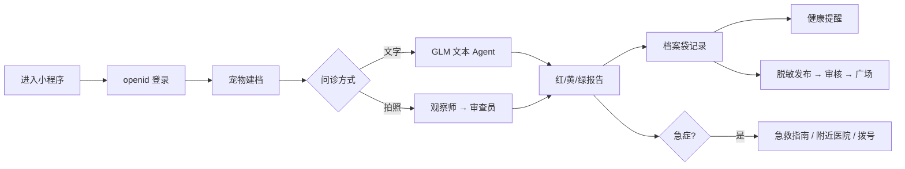

# AI 宠物助手（微信小程序）

以宠物档案为底座，用多模态大模型承接日常咨询与症状初判，把每次交流沉淀为可回溯的健康记录，再用提醒、问诊广场、急救指南和附近医院，把「知道该做什么」变成「真的做到了」。

> **状态**：功能可演示，尚未正式上线｜**载体**：微信小程序 + 微信云开发｜**文档**：按竞赛规范 a–g 组织，见[文档导航](#文档导航)。

<p></p>

---

## a. 项目说明

**解决的问题**：宠物主在「要不要去医院」上缺判断依据，症状说不清、看过就忘、疫苗驱虫易漏、经验无处交流。

| 维度 | 内容 |
|---|---|
| 目标用户 | 新手宠物主、多宠家庭、预防型用户、预算敏感用户、内容贡献者 |
| 使用场景 | 日常咨询、症状初判、疫苗/驱虫/复诊提醒、问诊互助、急症应急、就近就医 |
| 核心闭环 | 建档 → 问诊 → 记录 → 提醒 → 互助/复诊 |
| 产品边界 | 不确诊、不开处方、不给剂量；急症直接引导线下就医 |

**核心流程**：



详细的目标用户画像、场景与 3 分钟演示脚本见 **[docs/01-project.md](docs/01-project.md)**。

## b. 小程序与 AI 能力

| 类别 | 已接入 | 未接入（附替代） |
|---|---|---|
| 微信小程序 | openid 登录、分享好友/朋友圈、订阅消息（模板待配）、定位/地图/导航、拨号、拍照/相册、图片预览、云存储、本地缓存、文本内容安全 | 微信支付、语音识别、微信 OCR 插件、手机号快速验证、客服消息 |
| 微信云开发 | 8 个云函数、12 个集合、云存储、每天 9:00 定时触发器、云调用 OpenAPI、环境变量 | — |
| AI 能力 | 智谱 `glm-4-flash` 文本、`glm-4.6v-flash`/`glm-4v-flash` 视觉、Function Calling Agent（2 个工具）、RAG（约 875 条）、图像两阶段诊断、视觉 OCR、情感安抚、本地规则降级 | 多轮上下文、向量检索 |

- **登录**：默认 openid 一键登录；验证码为演示实现；账号密码/找回密码可用。
- **订阅消息**：授权与定时推送链路已就绪，模板 ID 为空时仅应用内提醒。
- **内容安全**：问诊文本、帖子/评论接 `msgSecCheck`；图片与 AI 输出尚未校验。
- **AI 边界**：药品仅给类别，不给具体药名与剂量；所有报告附免责声明。

逐项接口、代码位置与未接入原因见 **[docs/02-capabilities.md](docs/02-capabilities.md)**。

## c. 创新点

| 维度 | 创新点 |
|---|---|
| AI 应用 | 观察师先做 OCR/影像观察，再用关键词联合检索知识库，最后由审查员交叉验证 |
| 场景 | 问诊不是终点，而是档案袋、提醒、社区内容的起点 |
| 产品 | 先审后发 + 举报下架的宠物健康社区，官方/精选内容保底 |
| 技术 | 60s 云函数预算内的多模型编排、逐级回退与可测降级 |
| 商业模式 | 基础工具免费，深度报告/多宠家庭/医院合作增值（规划中） |
| 用户体验 | 红黄绿分级、急症兜底、失败不白屏、档案自动带入 |

六维的差异点、证据与边界见 **[docs/03-innovation.md](docs/03-innovation.md)**。

## d. 技术实现

```text
微信小程序（原生 WXML/WXSS/JS，26 页）
  └─ utils/cloud.js ── 统一 callFunction / 超时 / { ok, data, msg }
       ├─ login / pet / record / reminder / square / admin
       ├─ assistant ── 智谱 GLM
       │                ├─ RAG 私有知识库（kb_docs / kb_meta，约 875 条）
       │                ├─ Open-Meteo 天气工具
       │                └─ 腾讯位置服务 POI（附近医院）
       └─ notify ── 每天 9:00 定时触发 → 订阅消息
  └─ 云数据库（12 集合）/ 云存储（consult/{openid}/...）
```

**页面结构**：3 个 Tab（AI问诊 / 问诊广场 / 我的），共 26 页；记录、提醒、发布、收藏、历史等从「我的」进入独立页。

**前后端协同**：小程序不直接读写数据库，全部经云函数；成功 `{ ok: true, data }`，失败 `{ ok: false, msg, detail }`；默认 60s、AI 55s、医院 15s 超时。

**关键代码**（文本 Agent 工具循环，`cloudfunctions/assistant/index.js`）：

```js
for (let round = 0; round < MAX_TOOL_ROUNDS; round++) {
  if (remainingMs() < 12000) break
  const res = await callZhipuWithRetry({
    model: TEXT_MODEL, messages, tools: TOOLS,
    temperature: 0.2, max_tokens: 1024,
    timeoutMs: Math.min(25000, remainingMs())
  }, remainingMs)
  const msg = res.choices[0].message
  if (msg.tool_calls && msg.tool_calls.length) {
    // 执行 get_weather / search_kb，结果截断 3000 字符后回填
    messages.push({ role: 'assistant', content: msg.content || '', tool_calls: msg.tool_calls })
    for (const tc of msg.tool_calls) {
      const result = await runTool(tc.function.name, JSON.parse(tc.function.arguments || '{}'))
      messages.push({ role: 'tool', tool_call_id: tc.id, content: JSON.stringify(result).slice(0, 3000) })
    }
    continue
  }
  finalContent = msg.content || ''
  break
}
```

**AI 接入与难点**：模型预算、提示词结构、两阶段图像、RAG、JSON 解析、图片 base64、数据隔离等 8 项难点与解法，见 **[docs/04-technical.md](docs/04-technical.md)** 与 **[docs/ai.md](docs/ai.md)**。

**数据与部署**：集合字段/索引见 **[docs/data-model.md](docs/data-model.md)**；环境变量、8 函数部署、管理员初始化见 **[docs/deploy.md](docs/deploy.md)**。

## e. 成果展示

| AI 对话（分级报告） | 问诊广场 | 附近医院 |
|---|---|---|
|  |  |  |

- **11 张真实截图**：问诊首页、拍照表单、AI 对话、记录、提醒、广场、帖子详情、医院、急救、管理入口、个人中心，均为开发者工具实拍。
- **关键流程**：登录→建档、文字问诊→记录、拍照两阶段、提醒创建、广场发布→审核、急症→急救/医院，共 6 条。
- **测试记录**：`npm test` **7/7 通过**；49 个 JS 文件语法检查 **0 错误**；26 页 / 8 云函数 / 12 集合计数一致。

全部截图、流程说明与限制见 **[docs/05-results.md](docs/05-results.md)**。

## f. 历史说明

**无往届参赛成果**，本项目不是往届作品的迭代版本。

仓库自身经历 v1.0（2026-10-22 需求基线，22 页/7 云函数/规则回复）→ v2.0（当前，26 页/8 云函数/GLM+RAG+广场+审核+7 个单测）。完整时间线与 12 项优化明细见 **[docs/06-history.md](docs/06-history.md)**。

## g. 落地规划

| 阶段 | 时间 | 目标 |
|---|---|---|
| T0 合规整改 | 第 1–2 周 | 替换默认口令、移除管理员白名单、真实短信、图片/AI 内容安全、订阅消息模板、索引与类目 |
| T1 小范围灰度 | 第 3–4 周 | 50–100 名种子用户，验证留存、AI 成功率与内容治理 |
| T2 正式发布 | 第 5–6 周 | 提交审核、配置搜一搜、官方内容、客服/举报机制 |

- **增长**：校园/宠物社群冷启动、医院门店合作、内容平台、微信搜一搜、帖子/急救分享。
- **运营**：发帖 4 小时内审核、举报 24 小时内处理、每月知识库更新、官方内容周更。
- **商业**：基础免费；会员/深度报告/医院合作/品牌内容（规划中），急症不设付费墙。
- **迭代**：V2.1 合规上线 → V2.2 多轮上下文/意图路由/急症硬拦截 → V2.3 语音与社区体验 → V3.0 商业化试点。

完整上线清单、指标与风险见 **[docs/07-roadmap.md](docs/07-roadmap.md)**。

---

## 快速开始

1. 用[微信开发者工具](https://developers.weixin.qq.com/miniprogram/dev/devtools/download.html)导入仓库根目录，确认 AppID 与云环境（`project.config.json`、`miniprogram/config.js`，默认 `ai-d5gc65qrdab971a09`）。
2. 部署全部 8 个云函数（右键 →「上传并部署：云端安装依赖」）：`login`、`pet`、`record`、`reminder`、`square`、`admin`、`assistant`、`notify`。
3. 配置 `assistant` 环境变量 `ZHIPU_API_KEY`；如需真实附近医院，再配 `TENCENT_MAP_KEY`。
4. 初始化管理员：登录页 →「管理员登录」→ 首次用 `admin / Admin@123456` 创建并绑定当前微信；上线前必须按 [docs/deploy.md](docs/deploy.md#52-修改默认口令上线必做) 替换。
5. 编译运行。集合按需自动创建；建议补 `reminders` 的 `_openid + dueAt` 索引。

订阅消息、索引、权限、排障与上线检查清单见 **[docs/deploy.md](docs/deploy.md)**。

## 仓库结构

```text
miniprogram/
  app.js / app.json / app.wxss     # 全局逻辑、页面与 tabBar、主题
  config.js                        # 云开发环境 ID（唯一来源）
  utils/                           # cloud.js / util.js / petDict.js / history.js
  images/tabbar/  assets/          # tabBar 图标、地图标记
  pages/
    consult/ consultForm/ chat/    # 问诊首页、拍照表单、对话
    recordDetail/ recordsList/     # 记录详情与分类列表
    reminders/ reminderEdit/       # 健康计划与提醒编辑
    square/ postDetail/ topic/     # 广场、帖子、发帖
    searchPosts/ myPosts/ likedPosts/ history/ messages/
    hospitals/ firstaid/ settings/
    mine/ addPet/ login/ forgotPassword/ setPassword/
    admin/ adminLogin/             # 管理后台与登录
    featured/                      # 遗留页（无入口）
cloudfunctions/
  login/ pet/ record/ reminder/ square/ admin/
  assistant/                       # AI + RAG + 医院 POI + 知识库种子
  notify/                          # 订阅消息定时推送
test/                              # assistant 图像流程离线单测
docs/                              # a–g 七篇 + AI/数据模型/部署
spec.md                            # 产品规格（as-built）
```

## 文档导航

| 规范 | 文档 | 内容 |
|---|---|---|
| a | [docs/01-project.md](docs/01-project.md) | 定位、目标用户、场景、核心流程、功能清单 |
| b | [docs/02-capabilities.md](docs/02-capabilities.md) | 微信/云开发/AI 能力矩阵与未接入项 |
| c | [docs/03-innovation.md](docs/03-innovation.md) | 六维创新与证据 |
| d | [docs/04-technical.md](docs/04-technical.md) | 架构、页面结构、协同、关键代码、AI 难点 |
| e | [docs/05-results.md](docs/05-results.md) | 11 张截图、6 条流程、测试记录 |
| f | [docs/06-history.md](docs/06-history.md) | 无往届成果 + 仓库自身迭代 |
| g | [docs/07-roadmap.md](docs/07-roadmap.md) | 上线、增长、运营、商业、版本路线 |
| 深入 | [docs/ai.md](docs/ai.md) | 模型、Agent、两阶段图像、RAG、降级 |
| 深入 | [docs/data-model.md](docs/data-model.md) | 12 集合字段、索引、敏感数据 |
| 深入 | [docs/deploy.md](docs/deploy.md) | 环境变量、部署、管理员、订阅消息、排障 |
| 规格 | [spec.md](spec.md) | 产品规格与实现边界（as-built） |

## 测试

```bash
npm test                        # 无需安装依赖：图像问诊两阶段流程 7 个用例
npm install && npm run lint     # 可选；ESLint 配置较旧，可按需调整
```

## 已知限制

- **短信验证码为演示实现**：`login.sendCode` 直接回传验证码，生产环境需接真实短信。
- **订阅消息待模板**：`notify` 与 `reminderEdit` 的模板 ID 为空，当前仅应用内提醒。
- **内容安全为 fail-open**：文本校验失败时放行；图片与 AI 输出未校验。
- **默认管理员口令**：`admin / Admin@123456` 仅用于首次播种，上线前必须替换。
- **AI 边界**：仅初步评估，不确诊、不开处方、不给剂量；急症请立即就医。
- **测试覆盖**：仅 assistant 图像流程有单测，无 UI 自动化与真机专项测试。
- **遗留项**：`pages/featured` 无入口；`package.json` 仍有模板残留依赖。

## License

[MIT](LICENSE)
