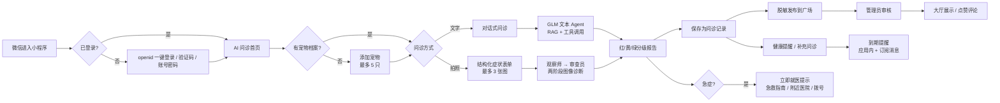

# 01 · 项目说明

> 对应文档规范 **a**：功能介绍、目标用户、使用场景、核心流程。
> 产品规格见 [spec.md](../spec.md)，技术细节见 [04-technical.md](./04-technical.md)。

## 1. 一句话定位

**AI 宠物助手**是一款基于微信云开发的养宠助手：以宠物档案为底座，用多模态大模型承接日常咨询与症状初判，把每次交流沉淀为可回溯的健康记录，再用提醒、问诊广场、急救指南和附近医院，把「知道该做什么」变成「真的做到了」。

- 载体：微信小程序（原生框架）+ 微信云开发
- 当前状态：功能可演示，尚未正式上线
- 核心闭环：**建档 → 问诊 → 记录 → 提醒 → 互助/复诊**

## 2. 解决的问题

| 痛点 | 现状 | 本项目的做法 |
|---|---|---|
| 不确定要不要去医院 | 搜索引擎信息碎片化、广告多 | 红/黄/绿三级初判 + 就医时机 + 检查项目清单 |
| 症状说不清 | 到医院后忘记细节 | 结构化拍照表单 + 对话式补充 + 图片/视频留证 |
| 看过就忘 | 聊天记录散落、无法回溯 | 一次问诊一个「档案袋」，可回看、重命名、发布 |
| 防大于治 | 疫苗/驱虫/复诊容易漏 | 六类健康提醒 + 周期自动排下一次 |
| 经验无处交流 | 宠物群信息噪声大 | 先审后发的问诊广场 + 举报与管理员治理 |

## 3. 目标用户

| 用户画像 | 特征 | 核心诉求 | 典型场景 |
|---|---|---|---|
| 新手宠物主 | 第一次养猫/狗，缺乏基础医学常识 | 快速判断严重程度、知道下一步做什么 | 猫咪呕吐、狗狗软便、幼犬疫苗怎么打 |
| 多宠家庭 | 2–5 只宠物，记录容易混 | 分宠建档、分宠记录、分宠提醒 | 一只驱虫、另一只复诊，避免记混 |
| 预防型用户 | 关注疫苗、驱虫、体重与日常养护 | 周期提醒、养护知识 | 每月体内外驱虫、每年加强疫苗 |
| 预算敏感用户 | 希望先初判再决定是否就医 | 低成本、可解释的初步评估 | 夜间轻微症状，先判断要不要急诊 |
| 内容贡献者 | 愿意分享问诊经验 | 被看见、被审核保护 | 发布脱敏问诊记录、参与评论互助 |

## 4. 使用场景

1. **日常咨询**：换粮、洗澡、掉毛、行为异常等非急症问题，直接文字问诊。
2. **症状初判**：拍摄患处/化验单/疫苗本，填写结构化表单，获得分级报告。
3. **健康计划**：为每只宠物建立疫苗、体内驱虫、体外驱虫、复诊、用药、自定义提醒。
4. **问诊互助**：把脱敏记录发布到广场，查看精选/官方内容，点赞、收藏、评论、举报。
5. **急症应急**：离线急救指南 + 急症词红色预警 + 一键拨打医院电话。
6. **就近就医**：定位检索 5km 内宠物医院，地图导航或直接拨号；接口失败时展示演示数据并说明原因。

## 5. 核心流程

### 流程说明

1. **登录**：默认使用云开发 `openid` 一键登录；也支持手机验证码、账号密码、找回/设置密码。管理员登录态与普通用户分离。
2. **建档**：名字必填，支持头像（相册或 emoji）、分类-品种联动、性别、生日、体重、绝育、驱虫、疫苗；服务端强制 5 只上限。
3. **问诊**：文字问诊直接进入对话；拍照问诊先填类型/患处/病程/瘙痒/食欲/疫苗等结构化信息，再上传最多 3 张图。
4. **出报告**：模型返回 `level / summary / content / followUp`，前端按红黄绿渲染，并固定追加「不能替代执业兽医」免责声明。
5. **沉淀**：对话可随时保存为记录；记录支持重命名、回看、删除、转提醒、补充问诊、发布广场。
6. **跟进**：提醒支持待办/完成/跳过/过期流转，周期提醒完成后自动排下一次；订阅消息模板配置后由每天 9:00 的定时触发器推送。
7. **互助与治理**：用户发帖进入 `pending`，管理员审核通过后才进大厅；被举报可下架并通知作者。

## 6. 功能清单

状态：✅ 已实现｜🔶 部分实现｜⏳ 规划中

| 模块 | 能力 | 入口 | 状态 |
|---|---|---|---|
| 账号 | openid 一键登录、验证码登录、账号密码、找回/设置密码 | `pages/login`、`forgotPassword`、`setPassword` | ✅ |
| 宠物档案 | 多宠管理（≤5）、头像、分类品种、生日年龄、体重、绝育、驱虫、疫苗 | `pages/addPet`、`consult` | ✅ |
| 文字问诊 | 快捷问题 + 自由输入、多会话、图片/视频附件、补充问诊 | `pages/chat` | ✅ |
| 拍照问诊 | 结构化表单、≤3 张图、两阶段视觉诊断、报告页 | `pages/consultForm`、`chat?mode=photo` | ✅ |
| AI 能力 | GLM 文本 Agent、RAG 知识库、天气工具、情感安抚、本地规则降级 | `cloudfunctions/assistant` | ✅ |
| 问诊记录 | 档案袋、分类列表、详情、重命名、删除、转提醒、发布 | `pages/recordsList`、`recordDetail` | ✅ |
| 健康计划 | 六类提醒、周期重复、状态流转、应用内提醒 | `pages/reminders`、`reminderEdit` | ✅ |
| 订阅消息 | 授权请求、每天 9:00 定时扫描推送 | `reminderEdit`、`cloudfunctions/notify` | 🔶 模板 ID 待配 |
| 问诊广场 | 大厅/精选/官方、搜索、点赞、收藏、评论、举报、通知 | `pages/square`、`postDetail`、`messages` | ✅ |
| 内容治理 | 先审后发、我的发布、审核通知、举报处理、下架原因 | `pages/myPosts`、`admin` | ✅ |
| 个人中心 | 我的宠物、发布/收藏/点赞/历史、健康计划、记录、医院、设置 | `pages/mine` | ✅ |
| 辅助工具 | 离线急救指南、附近医院（定位/地图/拨号/降级） | `pages/firstaid`、`hospitals` | ✅ |
| 管理后台 | 账号管理、帖子审核、举报处理、知识库、数据概览 | `pages/admin`、`adminLogin` | ✅ |
| 多轮上下文 | 模型侧透传 `recentMessages` | — | ⏳ |
| 支付/会员 | 微信支付、会员权益 | — | ⏳ 未接入 |

页面共 26 个（含 3 个 Tab），完整地图见 [04-technical.md §2](./04-technical.md#2-页面结构设计)。

## 7. 演示路径与录屏建议

### 演示步骤（3 分钟）

1. 首页 → 添加宠物「豆豆」→ 保存 → 回到首页看到宠物卡。
2. 点宠物卡 → 文字问诊「猫咪今天吐了两次，精神还行」→ 查看分级与追问。
3. 返回首页 →「拍照问诊」→ 填写表单 + 选图 → 生成报告 → 保存记录。
4. 「我的」→ 问诊记录 → 打开档案袋 → 转健康提醒 → 设置 7 天后复诊。
5. 广场 → 打开帖子 → 点赞/评论 → 发布一条脱敏记录 → 管理员后台审核通过。
6. 急救指南 → 选择「呼吸困难」→ 查看立即就医提示；附近医院 → 定位/演示数据 → 拨号。

### 录屏脚本（60–90 秒）

| 时间 | 画面 | 旁白要点 |
|---|---|---|
| 0–10s | 首页与宠物卡 | 一句话说明产品定位 |
| 10–30s | 拍照问诊表单 → 报告 | 强调结构化信息 + 两阶段视觉诊断 |
| 30–45s | 记录详情 → 转提醒 | 强调「一次问诊一个档案袋」 |
| 45–60s | 广场发布 → 审核 → 展示 | 强调先审后发与互助 |
| 60–75s | 急救指南 / 附近医院 | 强调急症兜底与落地闭环 |

> 录屏为规范建议项。录制后建议放在 `docs/assets/demo.mp4`，并在 [05-results.md](./05-results.md) 中引用；仓库当前未附视频，避免提交大文件。

## 8. 产品边界

- **不做在线诊断**：只提供初步评估与就医建议，不给出确诊结论。
- **不开处方、不给剂量**：药品仅给类别，具体药名与剂量必须由执业兽医决定。
- **不替代线下检查**：化验、影像、触诊等仍需到医院完成。
- **急症优先线下**：呼吸困难、大出血、误食毒物、抽搐、昏迷、休克、难产、排不出尿等直接提示立即就医。
- **当前不做**：在线问诊付费、宠物交易、商城、多端同步、真实短信（演示实现）。

---

**下一篇**：[02 · 小程序与 AI 能力](./02-capabilities.md)
