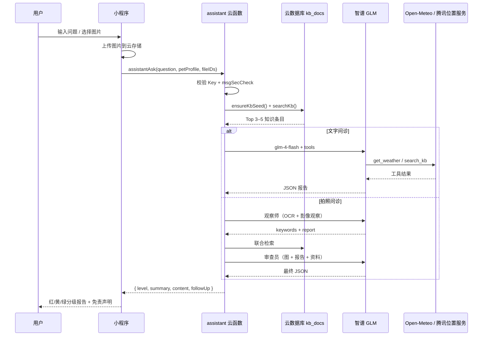

# 02 · 小程序与 AI 能力说明

> 对应文档规范 **b**：明确标注调用的微信小程序能力、云开发能力与 AI 能力。
> 状态图例：✅ 已接入｜🔶 部分接入｜⛔ 未接入（附替代方案）。

## 1. 微信小程序能力

| 能力 | 实际使用的接口/机制 | 状态 | 代码位置 | 说明 |
|---|---|---|---|---|
| 微信登录态 | 云函数 `cloud.getWXContext().OPENID` | ✅ | `cloudfunctions/login/index.js`、`miniprogram/app.js` | 通过云开发天然获取 openid，**未使用** `wx.login` + `code2session` |
| 分享给好友 | `onShareAppMessage` | ✅ | 26 个页面均实现 | 分享标题与路径按页面定制，如问诊首页、帖子详情 |
| 分享到朋友圈 | `onShareTimeline` | ✅ | 26 个页面均实现 | 需在公众平台开启对应能力 |
| 订阅消息 | `wx.requestSubscribeMessage` + `cloud.openapi.subscribeMessage.send` | 🔶 | `pages/reminderEdit/reminderEdit.js:185`、`cloudfunctions/notify/index.js:30` | 授权与定时推送链路已就绪，**模板 ID 为空**，当前仅应用内提醒 |
| 定位 | `wx.getLocation({ type: 'gcj02', isHighAccuracy: true })` | ✅ | `pages/hospitals/hospitals.js:143` | 需 `app.json` 的 `scope.userLocation` 与 `requiredPrivateInfos` |
| 地图导航 | `wx.openLocation` | ✅ | `pages/hospitals/hospitals.js:230,250` | 传入医院经纬度与名称，唤起微信内置地图 |
| 拨打电话 | `wx.makePhoneCall` | ✅ | `pages/hospitals/hospitals.js:245`、`pages/chat/chat.js:295` | 医院卡片与急症提示均可一键拨号 |
| 拍照/相册 | `wx.chooseMedia` | ✅ | `chat`、`consultForm`、`addPet`、`mine` | 问诊最多 3 张图；宠物/用户头像单图 |
| 图片预览 | `wx.previewImage` | ✅ | `chat`、`consultForm`、`postDetail`、`recordDetail` | 支持多图滑动与原图查看 |
| 云存储上传 | `wx.cloud.uploadFile` | ✅ | `utils/cloud.js:33` | 统一封装为 `cloud.uploadFile(tempFilePath, cloudPath)` |
| 云存储下载 | `cloud.downloadFile` | ✅ | `cloudfunctions/assistant/index.js` | 云函数侧下载问诊图片并转 base64 送模型 |
| 本地缓存 | `wx.setStorageSync / getStorageSync` | ✅ | `app.js`、`utils/history.js`、`likedPosts`、`square` | 登录态、收藏、浏览历史、免责同意标记 |
| 隐私与权限 | `app.json` → `permission` + `requiredPrivateInfos` | ✅ | `miniprogram/app.json` | 仅声明 `getLocation`，用途为查找附近医院 |
| 内容安全 | `cloud.openapi.security.msgSecCheck` | 🔶 | `cloudfunctions/square/index.js:224`、`cloudfunctions/assistant/index.js:1807` | 仅文本；接口异常时 fail-open；图片与 AI 输出未校验 |
| 微信支付 | — | ⛔ | — | 当前无付费功能；商业化见 [07-roadmap.md](./07-roadmap.md) |
| 语音识别 | — | ⛔ | — | 当前仅文字/图片输入；可后续接 `wx.getRecorderManager` + ASR |
| 微信 OCR 插件 | — | ⛔ | — | OCR 由视觉大模型在云函数内完成，未引入微信 OCR 插件 |
| 手机号快速验证 | — | ⛔ | — | 未用 `getPhoneNumber`；验证码为演示实现，账号密码为备选 |
| 客服消息 | — | ⛔ | — | 未接入客服会话；问题反馈走广场举报/设置页说明 |

### 1.1 登录方式（实际）

| 方式 | 入口 | 行为 | 状态 |
|---|---|---|---|
| openid 一键登录 | 登录页 | 调 `login.wxLogin`，按 openid 建立/读取 `users`，无需手机号 | ✅ 默认 |
| 手机验证码 | 登录页 | `sendCode` → `smsLogin`；验证码由云函数回传（演示） | 🔶 演示 |
| 账号密码 | 登录页 | `accountLogin`，账号由管理员创建或验证码首次登录时设置 | ✅ |
| 找回/设置密码 | `forgotPassword`、`setPassword` | 验证码校验后重置；密码 8–14 位且含英文与数字 | ✅ |
| 管理员登录 | 登录页底部 | `adminLogin`，独立登录态；首次用默认口令播种 | ✅ |

## 2. 微信云开发能力

| 能力 | 使用情况 | 明细 |
|---|---|---|
| 云函数 | 8 个 | `login`、`pet`、`record`、`reminder`、`square`、`admin`、`assistant`、`notify` |
| 云数据库 | 12 个集合 | `users`、`accounts`、`admins`、`sms_codes`、`pets`、`records`、`reminders`、`square_posts`、`square_reports`、`square_notifications`、`kb_docs`、`kb_meta` |
| 云存储 | 问诊图片/视频、头像 | 路径 `consult/{openid}/...`；删除记录不会自动清理文件 |
| 定时触发器 | 每天 09:00 | `cloudfunctions/notify/config.json` → `0 0 9 * * * *` |
| 云调用 OpenAPI | 订阅消息、内容安全 | `subscribeMessage.send`、`security.msgSecCheck`；权限在 `config.json` 声明 |
| 环境变量 | 模型与地图 Key | `ZHIPU_API_KEY`（必需）、`TENCENT_MAP_KEY`（可选） |
| 云开发环境 | 单环境 | 环境 ID 唯一来源：`miniprogram/config.js` |
| 数据库权限 | 全部经云函数访问 | 集合可设为「所有用户不可读写」，云函数不受限制 |

> 详细字段、索引与权限见 [data-model.md](./data-model.md)；部署步骤见 [deploy.md](./deploy.md)。

## 3. AI 能力

| 能力 | 实现 | 状态 | 说明 |
|---|---|---|---|
| 文本大模型 | 智谱 `glm-4-flash` | ✅ | 支持 Function Calling，承担问诊主对话 |
| 视觉大模型 | `glm-4.6v-flash` → `glm-4v-flash` | ✅ | 多图优先 4.6V；4V 仅单图，自动取第一张 |
| Agent 工具调用 | `get_weather`、`search_kb` | ✅ | 最多 3 轮（`MAX_TOOL_ROUNDS=3`），工具结果截断 3000 字符 |
| RAG 检索增强 | `kb_docs` + `kb_meta` | ✅ | 约 875 条种子（基础 178 + v4–v9 共 697），标题/正文关键词加权 |
| 图像两阶段诊断 | 观察师 → 审查员 | ✅ | 观察师输出 `keywords/report`，联合检索后再由审查员终判 |
| OCR | 视觉模型内完成 | ✅ | 识别化验单、疫苗本、包装说明；非独立 OCR 服务 |
| 情感分析 | 关键词规则 | ✅ | 命中「担心/害怕/急/疼/抽搐」等词时先安抚再建议 |
| 结构化输出 | 强制 JSON + `parseJson` | ✅ | 容忍 ```json 代码块与多余文字 |
| 内容安全 | `msgSecCheck` | 🔶 | 仅问诊文本与帖子/评论；图片、AI 输出未校验 |
| 降级策略 | 本地规则 `util.aiConsult()` | ✅ | 模型/Key/网络失败时返回结构化建议，页面不白屏 |
| 多轮上下文 | `recentMessages` | ⛔ | 记录中有历史消息，但请求未透传；见 [07-roadmap.md](./07-roadmap.md) |
| 向量检索 | Embedding + 向量库 | ⛔ | 当前为轻量关键词检索，零额外成本、可解释 |

### 3.1 一次问诊的调用链



### 3.2 AI 输出约束

- 固定四段式：`level`（red/yellow/green）、`summary`、`content`、`followUp`。
- 药品只给**类别**，不给具体药名与剂量；不确诊、不开处方。
- 每份报告追加「不能替代执业兽医」免责声明。
- 模型不可用时回退本地规则，并在界面明确提示为规则建议。

## 4. 能力边界与合规

| 边界 | 说明 |
|---|---|
| 医疗边界 | 初步评估与就医建议，不构成诊断；急症直接引导线下就医 |
| 数据边界 | 业务数据按 `_openid` 隔离；密码只存 `passwordHash + salt` |
| 内容边界 | 帖子/评论先审后发；举报可下架；文本内容安全校验 |
| 隐私边界 | 仅申请定位权限；图片/视频经用户主动选择上传 |
| 演示边界 | 短信验证码回传、医院演示数据、订阅消息模板未配，均已在页面/文档标注 |

## 5. 未接入能力与替代方案

| 未接入 | 原因 | 当前替代 | 后续计划 |
|---|---|---|---|
| 微信支付 | 当前无付费场景 | 全部功能免费 | 会员/增值服务，见落地规划 |
| 语音识别 | 问诊以文字+图片为主 | 文字输入、快捷问题 | 接入录音 + ASR，降低输入成本 |
| 微信 OCR 插件 | 视觉模型已能识别单据 | 观察师模型 OCR | 单据结构化字段抽取 |
| 手机号快速验证 | 审核与资质限制 | openid 登录 + 验证码演示 | 上线前接真实短信或手机号能力 |
| 客服消息 | 未建客服体系 | 举报、设置页说明 | 接入客服消息与工单 |

---

**上一篇**：[01 · 项目说明](./01-project.md)　**下一篇**：[03 · 创新点](./03-innovation.md)
