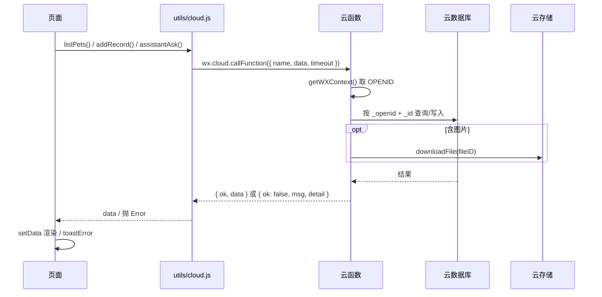

# 04 · 技术实现

> 对应文档规范 **d**：核心架构图、页面结构设计、前后端协同方式、关键代码片段、AI 接入方案及难点解决方案。
> 本文描述当前代码的实际结构；AI 细节见 [ai.md](./ai.md)，字段与索引见 [data-model.md](./data-model.md)，部署见 [deploy.md](./deploy.md)。

## 1. 总体架构

```text
┌──────────────────────────── 微信小程序 ────────────────────────────┐
│ pages/（26 个页面）                                                │
│   └─ utils/cloud.js  ── 统一 callFunction、超时、{ ok, data, msg } │
│   └─ utils/util.js   ── 日期/校验/提醒元数据/本地规则回复          │
│   └─ utils/history.js── 浏览历史（本地缓存）                       │
└───────────────────────────────┬────────────────────────────────────┘
                                │ wx.cloud.callFunction
┌───────────────────────────────▼────────────────────────────────────┐
│ 云函数（8 个）                                                     │
│  login pet record reminder square admin assistant notify           │
│    ├─ wx-server-sdk ── 云数据库 / 云存储 / openapi                │
│    ├─ 智谱 GLM（assistant）                                        │
│    ├─ 腾讯位置服务（assistant.nearbyHospitals）                    │
│    └─ Open-Meteo（assistant 天气工具）                             │
└───────────────────────────────┬────────────────────────────────────┘
                                │
┌───────────────────────────────▼────────────────────────────────────┐
│ 云数据库：users pets records reminders sms_codes accounts admins   │
│           square_posts square_reports square_notifications         │
│           kb_docs kb_meta                                          │
│ 云存储：consult/{openid}/...                                       │
└────────────────────────────────────────────────────────────────────┘
```

约定：云函数一律返回 `{ ok: true, data }` 或 `{ ok: false, msg, detail? }`；前端只处理 `data`，错误统一抛 `Error` 并 toast。

## 2. 页面结构设计

TabBar 三项（`app.json`）：**AI问诊 / 问诊广场 / 我的**。产品规格里的「助手 / 记录 / 我的」三 Tab 未落地，记录入口在「我的」。

| 分组 | 页面 | 说明 |
|---|---|---|
| Tab | `consult/consult` | AI 问诊首页：宠物横滑、拍照/文字入口、急救入口、说明卡 |
| Tab | `square/square` | 问诊广场：大厅 / 精选 / 官方，公告、搜索、消息角标 |
| Tab | `mine/mine` | 我的：用户卡、宠物卡、发布/收藏/点赞/历史、健康计划、记录、医院、设置 |
| 问诊 | `consultForm/consultForm` | 症状拍照表单（类型/患处/病程/瘙痒/食欲/疫苗）→ AI 报告 |
| 问诊 | `chat/chat` | 多会话对话、图片/视频附件、补充问诊、保存记录、发布广场 |
| 记录 | `recordDetail/recordDetail` | 消息流、删除、转提醒、补充问诊 |
| 记录 | `recordsList/recordsList` | 按拍照/文字分类的记录列表 |
| 提醒 | `reminders/reminders` | 健康计划列表与状态操作 |
| 提醒 | `reminderEdit/reminderEdit` | 新建/编辑提醒，请求订阅消息授权 |
| 广场 | `postDetail/postDetail` | 原图、点赞、评论、举报、收藏 |
| 广场 | `topic/topic` | 用户发帖 / 修改待审核帖 |
| 广场 | `searchPosts/searchPosts` | 关键词搜索 |
| 广场 | `myPosts/myPosts` | 我的发布（含审核状态、下架原因） |
| 广场 | `likedPosts/likedPosts` | 我的点赞；`?mode=fav` 为我的收藏 |
| 广场 | `history/history` | 浏览历史（本地） |
| 广场 | `messages/messages` | 互动/审核通知 |
| 宠物 | `addPet/addPet` | 添加/编辑宠物档案 |
| 工具 | `hospitals/hospitals` | 附近医院：定位 + 地图 + 导航/拨号，失败降级 |
| 工具 | `firstaid/firstaid` | 离线急救指南 |
| 工具 | `settings/settings` | 免责声明 / 隐私 / 内容安全 / 关于 |
| 账号 | `login/login` | 微信授权、验证码、账号密码、协议 |
| 账号 | `forgotPassword/forgotPassword` | 忘记密码：验证码校验 → 重置 |
| 账号 | `setPassword/setPassword` | 首次设置密码 / 重置密码 |
| 管理 | `adminLogin/adminLogin` | 管理员账号密码登录 |
| 管理 | `admin/admin` | 账号、帖子、审核、举报、知识库、数据概览 |
| 遗留 | `featured/featured` | 旧精选页，无入口 |

## 3. 前后端协同

### 3.1 调用协议

小程序端不直接读写数据库，所有业务请求都经 `utils/cloud.js` 调用云函数：

```js
function call(name, data, timeout) {
  return wx.cloud
    .callFunction({ name, data, timeout: timeout || 60000 })
    .then(res => {
      const result = res && res.result
      if (result && result.ok === false) {
        const detail = result.detail ? `｜${result.detail}` : ''
        return Promise.reject(new Error((result.msg || '操作失败') + detail))
      }
      return result ? result.data : null
    })
    .catch(err => {
      console.error(`[cloud] ${name}`, err)
      return Promise.reject(new Error((err && err.message) || '云函数调用失败，请确认已部署云函数'))
    })
}
```

| 约定 | 说明 |
|---|---|
| 成功 | `{ ok: true, data }`，前端只消费 `data` |
| 失败 | `{ ok: false, msg, detail? }`，`detail` 仅用于排查，不直接展示 |
| 超时 | 默认 60s；`assistantAsk` 55s；`nearbyHospitals` 15s |
| 错误提示 | 页面统一 `cloud.toastError(err)`，避免各页文案不一致 |
| 幂等 | 记录保存使用 `add` / `update` 明确区分；提醒完成按 `_id` 更新 |

### 3.2 一次请求的完整链路



### 3.3 前端分层

| 层 | 文件 | 职责 |
|---|---|---|
| 页面 | `pages/*` | 渲染、表单、交互、跳转；不直接访问数据库 |
| 调用封装 | `utils/cloud.js` | 统一云函数名、入参、超时、错误 |
| 业务工具 | `utils/util.js` | 日期、校验、提醒元数据、本地规则回复 |
| 字典 | `utils/petDict.js` | 分类-品种联动 |
| 本地状态 | `utils/history.js`、`wx.*Storage` | 浏览历史、收藏、登录态 |

### 3.4 云函数分层

| 层 | 说明 |
|---|---|
| 入口 | `exports.main(event)`，按 `event.action` 分发；`assistant` 默认 action 为问诊 |
| 鉴权 | `cloud.getWXContext().OPENID`；管理端再查 `admins` |
| 数据 | `wx-server-sdk` 的 `db` / `_` / `cloud.downloadFile` |
| 外部 | `assistant` 调智谱、Open-Meteo、腾讯位置服务；`notify` 调 `subscribeMessage.send` |
| 返回 | 统一 `{ ok, data, msg }`，异常兜底不抛裸对象 |

## 4. 云函数职责

### 4.1 `login` — 账号与会话

| action | 关键入参 | 行为 |
|---|---|---|
| `sendCode` | `phone` | 生成 6 位验证码，写 `sms_codes`（5 分钟有效）；**演示环境直接回传** |
| `smsLogin` | `phone, code` | 校验验证码；未设密码返回 `needSetPassword` |
| `checkPhoneRegistered` | `phone` | 查 `accounts` / `users` 是否已注册（找回密码用） |
| `verifyCode` | `phone, code, purpose` | 只校验不消费；`purpose=reset` 时要求已设密码 |
| `setPassword` | `phone, code, password, mode` | 注册/重置密码，写 `accounts`，登录并消费验证码 |
| `wxLogin` | — | 以 openid 建立/登录用户，无需手机号 |
| `updateProfile` | `nickname, avatarUrl` | 更新 `users` |
| `accountLogin` | `username, password` | 账号密码登录（账号由管理员创建，或验证码首次登录时设置密码生成） |
| `adminLogin` | `username, password` | 管理员登录；首次 `admin/Admin@123456` 自动播种到 `admins` |

密码规则：8–14 位、同时含英文与数字；`sha256(salt + '|' + password)` 存储。

### 4.2 `pet` / `record` / `reminder`

| 云函数 | action |
|---|---|
| `pet` | `list`、`count`、`get`、`add`、`update`、`remove`；`add` 服务端强制 5 只上限 |
| `record` | `list`、`get`、`add`、`rename`、`markPublished`、`update`、`remove` |
| `reminder` | `list`、`get`、`add`、`update`、`complete`、`skip`、`reopen`、`remove` |

`reminder` 细节：类型 `vaccine / deworm_in / deworm_out / recheck / medication / custom`；周期 `none / monthly / quarterly / yearly`；`list` 时把过期待办懒更新为 `expired`；`complete/skip` 后周期提醒自动排下一次（按月末对齐，`rootId` 去重）。

### 4.3 `square` — 问诊广场

| 分组 | action |
|---|---|
| 读 | `list`（`feed=recommend/latest`）、`search`、`featured`、`officialList`、`get`、`mylist`、`likedList`、`favlist` |
| 互动 | `like`、`comment`、`deleteComment`、`report` |
| 发布 | `publish`（进入 `pending`）、`editPost`（重新进审核）、`remove` |
| 通知 | `notifications`、`readNotifications`、`unread` |
| 管理 | `amIAdmin`、`adminPosts`、`adminPendingList`、`adminAudit`、`adminRemove`、`adminPublishOfficial`、`adminReports`、`adminHandleReport` |

- 用户发帖 `audit=pending`，管理员 `approved` 后才进大厅；被举报下架置 `rejected` 并写 `rejectReason`，不物理删除。
- `featured` / `officialList` 在缺少演示数据时会自动补齐，保证页面有内容。
- 文本内容经 `msgSecCheck`（`checkText`）校验，接口异常时放行。

### 4.4 `admin` — 后台

| action | 说明 |
|---|---|
| `isAdmin` | 当前 openid 是否在 `admins` |
| `addAccount` / `listAccounts` / `removeAccount` | 管理普通账号（手机号 + 密码） |
| `stats` | `users / pets / records / square_posts` 计数 + 最近 10 个用户 |

### 4.5 `assistant` — AI 与外部服务

| action | 说明 |
|---|---|
| 默认（无 action） | AI 问诊：文字 Agent / 图片两阶段诊断，见 [ai.md](./ai.md) |
| `nearbyHospitals` | 腾讯位置服务检索 5km 内「宠物医院」，环境变量 Key 失败时用本地 Key 重试 |
| `kbList` / `kbAdd` / `kbRemove` | RAG 知识库管理，仅 `admins` 可用 |

### 4.6 `notify` — 订阅消息

- `config.json` 已配置每天 9:00 的定时触发器（`0 0 9 * * * *`）与 `subscribeMessage.send` 权限。
- 扫描 `reminders` 中 `dueAt` 在 ±24 小时内且未推送的记录，发送后置 `notified: true`。
- 模板 ID 为空时跳过并返回 `skipped`，因此当前实际提醒仍以应用内为主。

## 5. 鉴权与数据隔离

| 身份 | 凭证 | 存储 | 作用域 |
|---|---|---|---|
| 普通用户 | 微信 openid（云函数 `getWXContext`） | `users._openid` | 自己的宠物、记录、提醒 |
| 账号 | 手机号 + 密码 | `accounts`（`passwordHash + salt`） | 登录后绑定到当前 openid |
| 管理员 | 账号 + 密码 | `admins`（`_openid` 绑定首次登录者） | 后台、审核、知识库 |

- 管理端登录态与普通登录态分开：`app.globalData.adminInfo` 与 `pet_admin` 缓存；普通用户是 `userInfo` 与 `pet_user`。
- 数据隔离：业务集合均带 `_openid`，查询与更新同时匹配 `_openid + _id`，避免越权。
- 广场管理员判定：`square` 先查硬编码 `ADMIN_OPENIDS`，再查 `admins` 集合（兼容两套）。上线前建议移除硬编码白名单。
- 前端需登录的操作统一走 `app.requireLogin()`；首页另有 `ensureLogin()` 弹窗引导。

## 6. 关键数据流

### 6.1 文字问诊

```text
consult → chat?mode=text → 输入/快捷问题 → send()
  → 上传图片（如有）到云存储
  → cloud.assistantAsk(question, petProfile, fileIDs)（超时 55s）
  → assistant：校验 Key → msgSecCheck → 下载图片 → RAG 检索 → 情感分析
       → 文本 Agent（get_weather / search_kb，最多 3 轮）→ JSON
  → chat 渲染 level/summary/content/followUp
  → saveRecord()：record.add / record.update
  → 失败：util.aiConsult() 本地规则兜底
```

### 6.2 拍照问诊

```text
consult → consultForm → 填写结构化表单 + 拍照（最多 3 张）
  → 上传云存储 → assistantAsk(结构化描述, pet, fileIDs)
  → assistant：观察师（OCR + 影像观察，输出 keywords/report）
       → 用「描述 + keywords」二次检索知识库
       → 审查员结合图片 + 观察报告 + 知识库输出最终 JSON
  → 报告页展示；addRecord 保存（consultType=photo）
  → 「补充问诊」把上下文挂到 app._supplementContext → chat
```

### 6.3 广场发布与审核

```text
chat/记录详情/topic → square.publish（脱敏字段）→ audit=pending
  → 管理员 admin.adminPendingList → adminAudit(approved/rejected)
  → 写 square_notifications 通知作者
  → approved 进入大厅 / 精选可见范围
  → 举报 → square_reports(pending) → adminHandleReport（可置 rejected 下架）
```

### 6.4 提醒推送

```text
reminderEdit → requestSubscribeMessage（模板 ID 非空时）
  → reminder.add（status=pending, notifiedAt=0）
  → 每天 9:00 notify 定时触发
  → 查 dueAt ∈ [now-24h, now+24h) 且 notified != true
  → subscribeMessage.send → notified=true（失败记日志，43101 视为未订阅）
```

### 6.5 附近医院

```text
hospitals.onShow → wx.getLocation(gcj02, 高精度)
  → cloud.nearbyHospitals(lat,lng)（15s 超时）
  → assistant 腾讯 POI（5km，page_size=20）
  → 前端哈弗辛公式算距离并排序
  → 失败/无结果：演示数据 + errMsg + demoMode 提示
```

## 7. 关键代码片段

> 以下均为仓库中的真实实现，省略了与说明无关的分支。

### 7.1 文本 Agent：工具调用循环（`cloudfunctions/assistant/index.js`）

```js
const messages = [
  { role: 'system', content: sysPrompt },
  { role: 'user', content: userText }
]
let finalContent = ''
for (let round = 0; round < MAX_TOOL_ROUNDS; round++) {
  // 预算耗尽：停止发起新一轮模型调用，用已获取的信息兜底回复
  if (remainingMs() < 12000) break
  const res = await callZhipuWithRetry({
    model: TEXT_MODEL,
    messages,
    tools: TOOLS,
    temperature: 0.2,
    max_tokens: 1024,
    timeoutMs: Math.min(25000, remainingMs())
  }, remainingMs)
  const msg = res.choices[0].message
  if (msg.tool_calls && msg.tool_calls.length) {
    messages.push({ role: 'assistant', content: msg.content || '', tool_calls: msg.tool_calls })
    for (const tc of msg.tool_calls) {
      const args = JSON.parse(tc.function.arguments || '{}')
      const result = await runTool(tc.function.name, args)
      messages.push({ role: 'tool', tool_call_id: tc.id, content: JSON.stringify(result).slice(0, 3000) })
    }
    continue
  }
  finalContent = msg.content || ''
  break
}
```

要点：工具结果截断 3000 字符；预算 <12s 不再发起新轮；最多 3 轮，避免无限调用。

### 7.2 轻量 RAG：分词与加权检索（`cloudfunctions/assistant/index.js`）

```js
function tokenize(query) {
  const t = String(query || '').toLowerCase()
  const terms = new Set()
  t.split(/[\s,，。.!?？;；、]+/).forEach(w => { if (w.length >= 2) terms.add(w) })
  const cjk = t.replace(/[^\u4e00-\u9fa5a-z0-9]/g, '')
  for (let i = 0; i + 2 <= cjk.length; i++) terms.add(cjk.slice(i, i + 2))
  return [...terms].filter(w => w.length >= 2).slice(0, 30)
}

async function searchKb(query, topN) {
  const terms = tokenize(query)
  if (!terms.length) return []
  const docs = await fetchAllKbDocs()
  return docs
    .map(d => {
      let score = 0
      terms.forEach(t => {
        if (String(d.title).indexOf(t) >= 0) score += 3
        if (String(d.content).indexOf(t) >= 0) score += 1
      })
      return { d, score }
    })
    .filter(x => x.score > 0)
    .sort((a, b) => b.score - a.score)
    .slice(0, topN || 3)
}
```

要点：中文 2 字滑窗解决无空格分词；标题权重高于正文；分页读取避免单次 `get` 上限。

### 7.3 图像两阶段：观察师 → 审查员（`cloudfunctions/assistant/index.js`）

```js
// 阶段一：观察师逐图做影像学观察（失败不致命）
const obs = await observeImage(content)

// 用「用户文字 + 观察师关键词」联合检索，纯图片也能命中知识库
const kbQuery = `${question || ''} ${((obs && obs.keywords) || []).join(' ')}`.trim()
const imgKbDocs = kbQuery ? await searchKb(kbQuery, 5).catch(() => []) : []

// 阶段二：审查员结合图片、观察报告与知识库交叉验证
const reportText = obs && obs.report ? obs.report : ''
const reviewUser =
  `${buildPetText(petProfile)}\n\n用户描述：${question || '（仅上传了照片，请结合照片分析）'}` +
  `\n\n【影像观察报告（初判模型输出，供交叉参考）】\n${reportText || '（首轮观察未产出，直接基于图片判断）'}`

for (const model of VISION_MODELS) {
  try {
    const res = await callZhipu({
      model,
      messages: [{ role: 'system', content: imgSysPrompt },
                 { role: 'user', content: reviewContent }],
      temperature: 0.15,
      max_tokens: 1024,
      timeoutMs: 25000
    })
    return { ok: true, model, data: parseJson(res.choices[0].message.content) }
  } catch (e) {
    // 换下一个视觉模型
  }
}
```

要点：观察师失败可跳过；`glm-4v-flash` 只保留首图 + 文本；审查员固定低温度保证稳定。

### 7.4 订阅消息扫描（`cloudfunctions/notify/index.js`）

```js
const res = await db.collection(REMINDERS).where({
  dueAt: _.gte(now - DAY).and(_.lt(now + DAY)),
  notified: _.neq(true)
}).limit(100).get()

for (const item of res.data || []) {
  try {
    await cloud.openapi.subscribeMessage.send({
      touser: item._openid,
      templateId: TEMPLATE_ID,
      page: 'pages/reminders/reminders',
      data: {
        thing1: { value: (item.title || '宠物提醒').slice(0, 20) },
        time2: { value: formatTime(item.dueAt) }
      }
    })
    await db.collection(REMINDERS).doc(item._id).update({ data: { notified: true } })
  } catch (e) {
    // 43101：用户未订阅/订阅过期，属正常，不重试
  }
}
```

要点：到期前后 24 小时窗口；发送成功才置 `notified`；模板 ID 为空时整体跳过并返回 `skipped`。

## 8. AI 接入方案与难点

### 8.1 模型与预算

| 环节 | 模型 | 参数 | 预算 |
|---|---|---|---|
| 文本问诊 | `glm-4-flash` | `temperature=0.2`、`max_tokens=1024` | 单轮 ≤25s，总预算约 52s |
| 观察师 | `glm-4.6v-flash` → `glm-4v-flash` | `temperature=0.1`、`max_tokens=900` | 20s |
| 审查员 | 同上 | `temperature=0.15`、`max_tokens=1024` | 25s |
| 云函数 | — | `timeout: 60` | 前端调用 55s |

```text
0s ── 安全校验 / 下载图片 / RAG ── 10s ── 观察师 20s ── 30s ── 联合检索 + 审查员 25s ── 55s
                                           └─ 文本 Agent：最多 3 轮，每轮 ≤25s，剩余 <12s 停
```

### 8.2 提示词结构

1. 基础兽医问诊规则：准确性、物种差异、照片与描述矛盾处理、急症判红；
2. 图像能力说明：OCR + 影像观察；
3. RAG 资料：`[资料N] 标题 + 正文`，要求交叉验证；
4. 焦虑安抚：命中情感词时先安抚；
5. 纯文本工具说明：`get_weather` / `search_kb`；
6. 输出约束：强制 JSON，字段固定，禁止具体药名与剂量。

### 8.3 难点与解决方案

| 难点 | 现象 | 解决方案 | 剩余风险 |
|---|---|---|---|
| 云函数 60s 上限 | 图像两阶段 + 重试易超时 | 总预算 52s；单轮取剩余预算；<12s 停止新轮 | 极端网络下仍可能接近上限 |
| 多图模型能力差异 | 4V 只接受单图 | 4.6V 优先，4V 自动降为「首图 + 文本」 | 多图细节可能丢失 |
| 模型输出非 JSON | 带 ```json 或解释文字 | `parseJson` 剥离代码块、截取首尾花括号 | 完全非 JSON 时走兜底结构 |
| 图片传输 | 云存储 fileID 不能直接给模型 | 云函数 `downloadFile` → base64 data URL | 4MB/张限制，超限需压缩 |
| RAG 无语义召回 | 同义词、口语化描述漏检 | 中文 bigram + 标题加权 + 关键词联合检索 | 复杂语义仍需向量检索 |
| 内容安全 | 仅文本校验且 fail-open | `msgSecCheck` 拦截违规文本；接口异常放行保证可用 | 图片/AI 输出未审核 |
| 多端状态 | 登录态、管理员态混用 | `pet_user` / `pet_admin` 分离；`requireLogin()` 统一拦截 | 登录态无自动续期 |
| 数据越权 | 客户端可伪造 id | 云函数同时匹配 `_openid + _id` | 管理员白名单仍有遗留 |

### 8.4 AI 降级顺序

```text
视觉首选模型失败 → 视觉次选模型 → 跳过观察直接审查
审查员全部失败 → 云函数返回 ok:false → 前端本地规则 aiConsult()
文本模型超时 → 预算内重试一次 → 仍失败 → 前端本地规则
Key 缺失 → 直接 ok:false → 前端本地规则
```

降级结果会在界面标注为「规则建议」或「演示数据」，不伪装成模型输出。

## 9. 约定与扩展点

- **新增页面**：在 `app.json.pages` 注册；新增 Tab 还要补 `images/tabbar/` 图标并改 `tabBar.list`。
- **新增云函数**：放到 `cloudfunctions/<name>/`，带 `package.json`；前端在 `utils/cloud.js` 增加封装。
- **新增集合**：云函数内先 `createCollection` 容错创建；所有用户数据带 `_openid`。
- **环境 ID**：只出现在 `miniprogram/config.js`，不要在页面里硬编码。
- **错误协议**：不要直接抛裸对象；保持 `{ ok, msg, detail }`，前端才能统一提示。
- **AI 输出**：保持 `level / summary / content / followUp` 四字段，前端渲染依赖它。

## 10. 相关文档

- [项目说明](./01-project.md)
- [能力说明](./02-capabilities.md)
- [创新点](./03-innovation.md)
- [成果展示](./05-results.md)
- [AI 实现](./ai.md)
- [数据模型](./data-model.md)
- [部署与运维](./deploy.md)
- [产品规格](../spec.md)
