# 05 · 成果展示

> 对应文档规范 **e**：功能界面截图、关键流程演示、运行效果、测试记录。
> 截图均为 2026-10-31 在微信开发者工具（iPhone 12/13 Pro 模拟器，390×671 逻辑分辨率，导出图 546×1179）中实拍，不是设计稿或后期合成。

## 1. 截图环境

| 项 | 值 |
|---|---|
| 工具 | 微信开发者工具（稳定版） |
| 基础库 | `3.17.3` |
| 模拟器 | iPhone 12/13 (Pro)，390×671 |
| 云环境 | `ai-d5gc65qrdab971a09` |
| 登录账号 | 演示用户（openid 登录） |
| 演示宠物 | `jiahao`（犬·柯基） |
| 医院定位 | 模拟坐标（北京 39.9042, 116.4074），POI 为腾讯位置服务真实返回 |

## 2. 功能界面截图

### 2.1 核心问诊链路

| 界面 | 截图 | 展示点 |
|---|---|---|
| AI 问诊首页 | 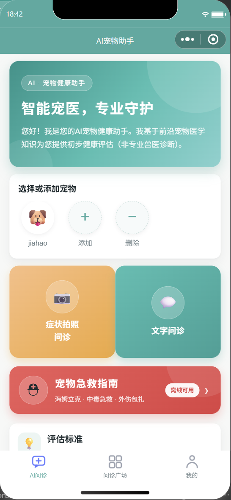 | 宠物横滑卡、拍照/文字双入口、急救入口、评估说明 |
| 拍照问诊表单 | 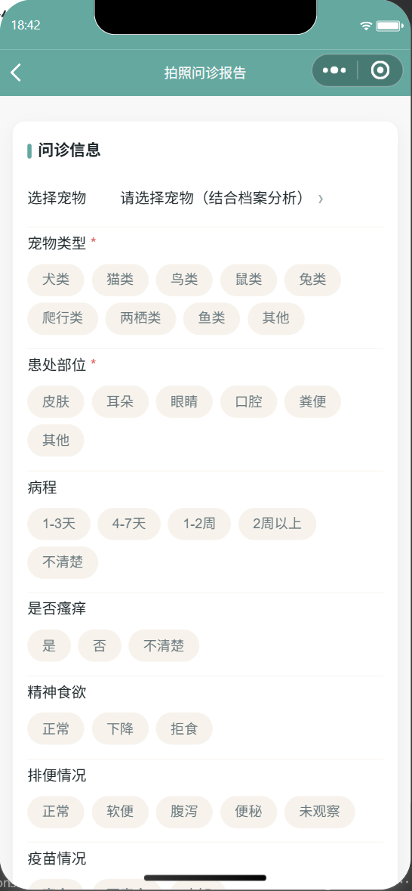 | 宠物选择、类型/患处/病程/瘙痒/食欲/排便/疫苗结构化字段 |
| AI 对话与分级建议 | 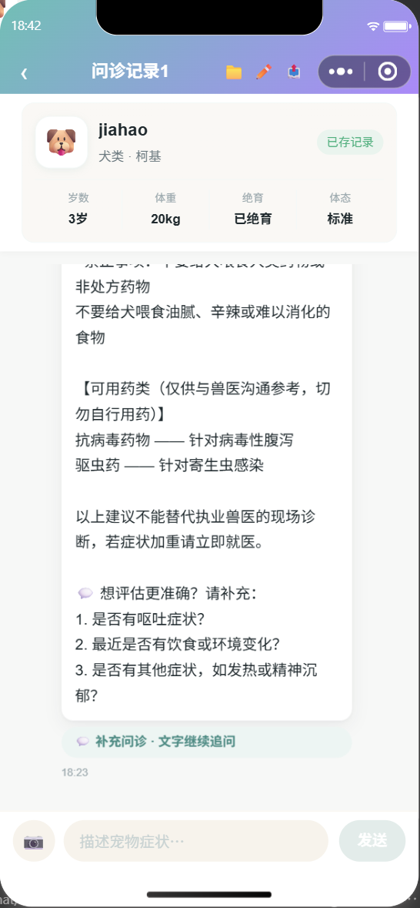 | 档案带入、结构化报告、追问、补充问诊、免责声明 |
| 问诊记录 | 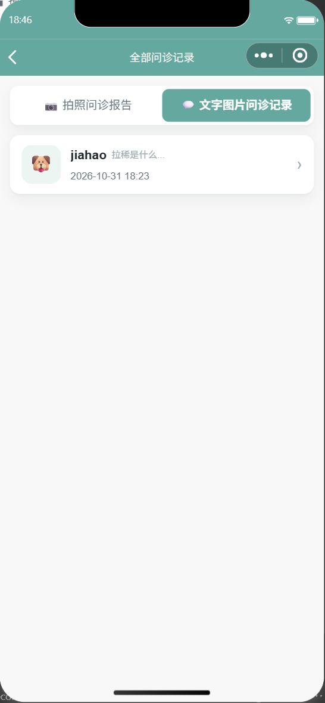 | 拍照/文字分类、宠物快照、时间与首问摘要 |
| 健康计划 | 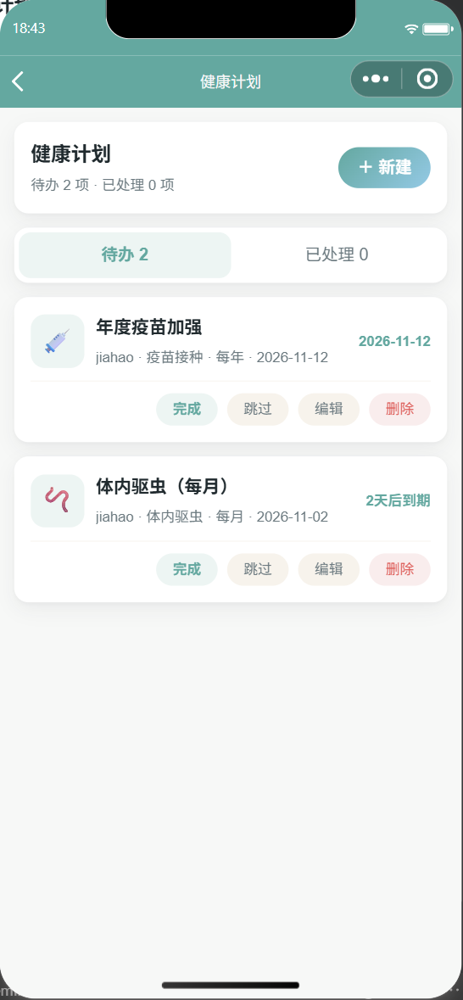 | 待办/已处理、到期时间、完成/跳过/编辑/删除 |

### 2.2 社区、工具与账号

| 界面 | 截图 | 展示点 |
|---|---|---|
| 问诊广场 | 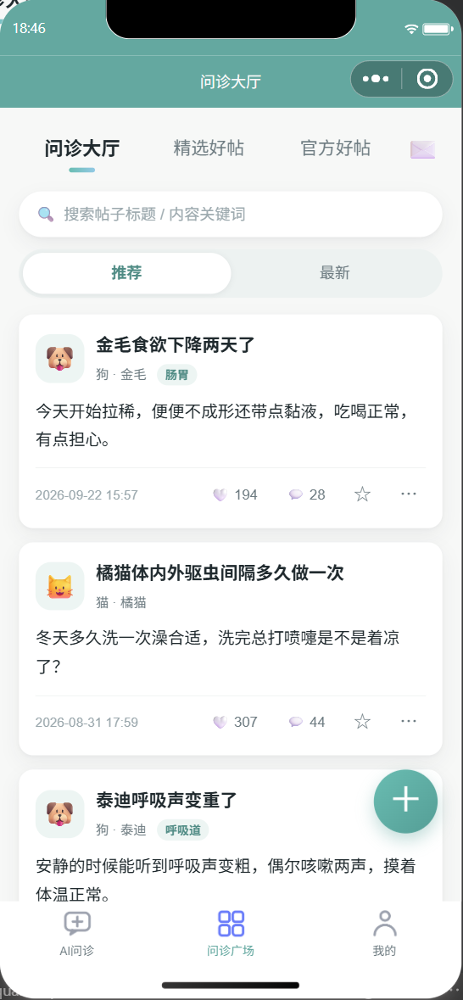 | 大厅/精选/官方、搜索、推荐/最新、点赞评论收藏 |
| 帖子详情 | 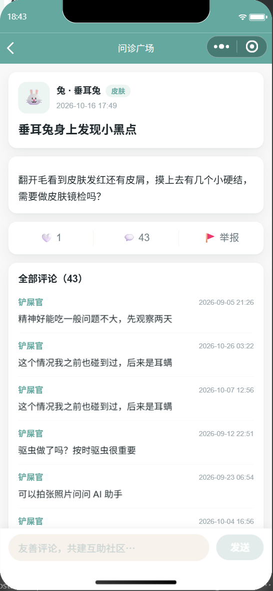 | 原图、点赞、评论列表、举报入口 |
| 附近医院 | 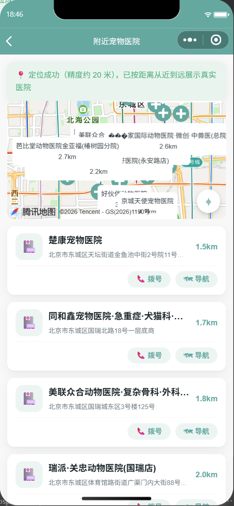 | 定位成功提示、地图、距离排序、拨号/导航 |
| 急救指南 | 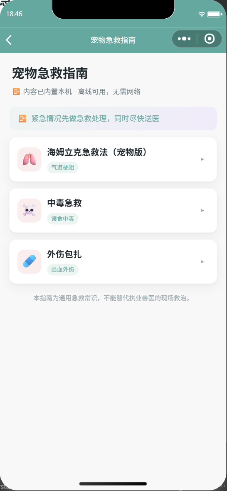 | 离线可用、海姆立克/中毒/外伤三类 |
| 管理入口 | 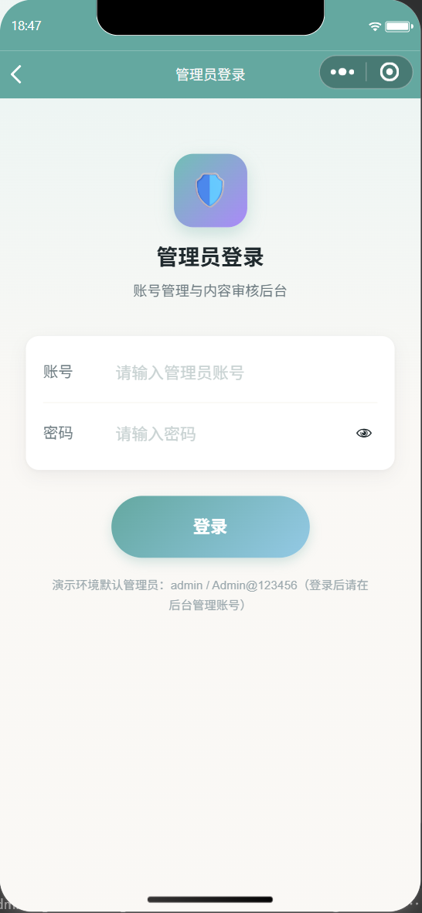 | 管理员独立登录态；默认口令仅演示，上线前必须替换 |
| 个人中心 | 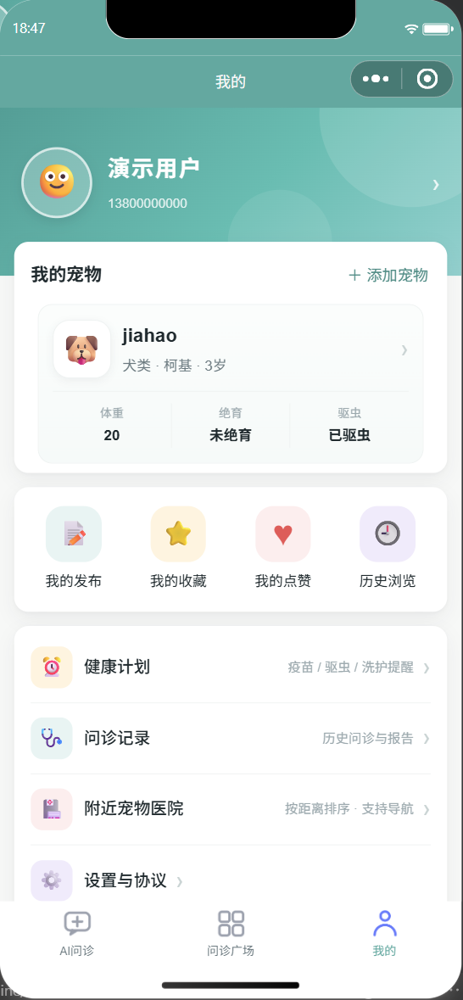 | 用户卡、宠物卡、发布/收藏/点赞/历史、健康计划、记录、医院 |

> 截图说明：第 5 张中的两条提醒是为展示界面临时创建的演示数据，截图后已删除。
> 第 10 张为管理入口而非后台首页：后台需要管理员 openid 绑定，为避免在开发环境留下管理员权限，本次未创建管理员账号。补拍方法见 [deploy.md §5](./deploy.md#5-管理员初始化)。

## 3. 关键流程演示

### 3.1 登录 → 建档

1. 进入小程序，未登录时提示「登录过期」，点「立即登录」。
2. 登录页选择 openid 一键登录（或验证码/账号密码）。
3. 回到 AI 问诊首页，点「添加」，填写名字、分类、品种、生日、体重等并保存。
4. 首页出现宠物卡，显示年龄、体重等派生信息。

**预期结果**：宠物卡可点击进入问诊；再次进入小程序登录态保持。
**对应截图**：01、11。

### 3.2 文字问诊 → 保存记录

1. 点宠物卡或「文字问诊」进入对话。
2. 输入「拉稀是什么原因」，等待模型返回。
3. 页面展示红/黄/绿分级、可能原因、家庭护理、就医建议、禁止事项、追问。
4. 返回「我的 → 问诊记录」，在「文字图片问诊记录」中看到该会话。

**预期结果**：报告字段完整，固定免责声明存在；记录可按宠物与时间回看。
**对应截图**：03、04。

### 3.3 拍照问诊 → 两阶段报告

1. 首页进入「症状拍照问诊」，选择宠物与类型/患处/病程等。
2. 上传 1–3 张患处或化验单照片（单张 ≤4MB）。
3. 提交后云函数先做观察师 OCR/影像观察，再联合知识库由审查员终判。
4. 报告页展示分级、分析、可能病症、护理、用药类别、就医与禁止事项。

**预期结果**：纯图片也能生成报告；观察师失败时自动跳过，不阻断问诊。
**对应截图**：02、03。

### 3.4 健康计划 → 提醒

1. 「我的 → 健康计划 → 新建」，选择宠物、类型、标题、到期日、重复周期。
2. 保存时请求订阅消息授权（模板 ID 配置后生效）。
3. 列表中可完成、跳过、编辑、删除；周期提醒完成后自动排下一次。
4. 过期待办在下次进入时自动置为「已过期」。

**预期结果**：待办/已处理数量实时更新；应用内提醒可用。
**对应截图**：05。

### 3.5 广场发布 → 审核 → 互动

1. 从记录详情或发帖页发布脱敏内容，提交后状态为 `pending`。
2. 管理员在后台「审核」通过后，帖子进入大厅。
3. 其他用户可点赞、收藏、评论、举报；作者收到互动/审核通知。
4. 被举报且管理员确认违规时下架，作者可在「我的发布」看到原因。

**预期结果**：未审核内容不出现在大厅；下架不物理删除，保留追溯。
**对应截图**：06、07、10。

### 3.6 急症 → 急救 / 就近就医

1. 首页点「宠物急救指南」，选择海姆立克/中毒/外伤查看步骤。
2. 首页或问诊结果进入「附近宠物医院」，授权定位后按距离排序。
3. 点「拨号」调用 `wx.makePhoneCall`，点「导航」调用 `wx.openLocation`。
4. 定位或接口失败时展示演示数据与失败原因，页面不白屏。

**预期结果**：急症场景有明确的线下动作，不依赖模型可用性。
**对应截图**：08、09。

## 4. 运行效果

- 26 个页面全部注册在 `app.json`，3 个 Tab（AI问诊/问诊广场/我的）可正常切换。
- 8 个云函数已部署，登录、宠物、记录、提醒、广场、后台、AI、推送链路可调用。
- 文字问诊在免费模型高峰期可返回完整结构化报告；超时/失败时回退本地规则。
- 图片问诊两阶段链路可跑通；模型不可用时跳过观察师或整体降级。
- 附近医院在配置腾讯位置服务 Key 后返回真实 POI（截图为北京坐标实测）。
- 订阅消息链路已就绪，模板 ID 为空时跳过推送，不影响应用内提醒。

## 5. 测试记录

执行日期：2026-10-31。

| 检查项 | 命令/方式 | 结果 |
|---|---|---|
| AI 图像流程单测 | `npm test` | **7 个用例，失败 0** |
| JS 语法检查 | Node 逐文件 `new Function` 解析 | **49 个 JS 文件，0 错误** |
| 文档链接/锚点 | 自建 Node 脚本扫描 README/docs | 见下方「文档校验」 |
| 页面/云函数计数 | 对照 `app.json` 与 `cloudfunctions/` | 26 页 / 8 云函数 / 12 集合，一致 |
| 手动主链路 | 开发者工具逐页操作 + 截图 | 登录、建档、文字问诊、记录、提醒、广场、医院、急救均通过 |
| 真机验证 | 微信真机预览 | 未执行（当前仅模拟器） |

单测覆盖的 7 个用例：

1. 纯图片两阶段：观察师报告 + 关键词 → 知识库注入 → 审查员终判；
2. 观察师首选模型失败 → 回退次级模型；
3. 观察师全部失败 → 跳过观察直接诊断；
4. 关键词无知识库命中 → 不注入资料；
5. 文字 + 图片 → 联合检索知识库；
6. 医院接口不可用 → 返回降级错误；
7. 知识库增量播种：只补新版本、不重复、不复活已删除条目。

> 单测通过 `Module._load` 拦截 `wx-server-sdk` 与 `https`，不发起真实网络请求，可在无网络环境重复执行。

## 6. 已知限制

- **仅模拟器截图**：上线前建议补真机截图与 60–90 秒录屏，覆盖深色模式/小屏机型。
- **管理后台未截图**：需要管理员 openid 绑定，避免污染开发环境权限；按 [deploy.md §5](./deploy.md#5-管理员初始化) 初始化后可补拍。
- **无 UI 自动化**：当前只有 AI 链路的离线单测，页面交互靠手动验证。
- **演示数据**：广场含自动播种的演示帖；医院在无 Key 时展示演示数据；验证码为演示实现。
- **订阅消息未实推**：模板 ID 为空，截图中的提醒仅为应用内状态。
- **性能未压测**：未做并发、冷启动、弱网专项测试。

---

**上一篇**：[04 · 技术实现](./04-technical.md)　**下一篇**：[06 · 历史说明](./06-history.md)
